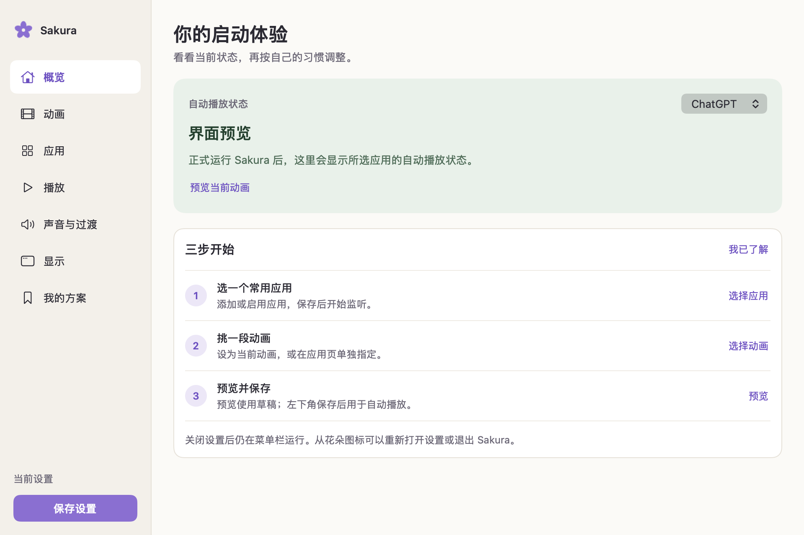
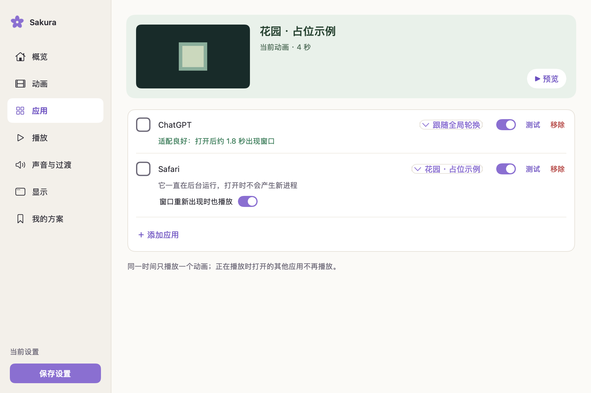

# Sakura

为应用启动，留一段喜欢的动画。

Sakura is a native macOS and Windows companion that plays a customizable animation when a selected application starts.

**开发者预览版** · macOS 13+ · Windows 11 / .NET 10 · MIT

## 下载

<!-- 发新版时更新这里的版本号（见 docs/RELEASING.md） -->
<h3 align="center">
  <a href="https://github.com/shishyguo-cyber/sakura-launcher/releases/download/v0.2.0-preview.5/Sakura-0.2.0-preview.5-macOS.zip">⬇ 下载 macOS 版</a>
  &nbsp;&nbsp;·&nbsp;&nbsp;
  <a href="https://github.com/shishyguo-cyber/sakura-launcher/releases/download/v0.2.0-preview.5/Sakura-0.2.0-preview.5-windows-x64.zip">⬇ 下载 Windows 版</a>
</h3>

v0.2.0-preview.5 开发者预览版 · <a href="https://github.com/shishyguo-cyber/sakura-launcher/releases/tag/v0.2.0-preview.5">所有下载、更新说明与校验值</a>

**第一次打开**

- **Mac**（macOS 13+，Apple 芯片与 Intel 通用）：解压后把 Sakura.app 拖进“应用程序”。预览版没有 Apple 开发者签名，第一次打开会被拦下，请到“系统设置 → 隐私与安全性”，在页面下方点“仍要打开”。
- **Windows**（Windows 11 x64）：先安装 [.NET 10 桌面运行时](https://dotnet.microsoft.com/download/dotnet/10.0)，把整个 Sakura 文件夹解压到固定位置，再双击 Sakura.exe。如果出现“Windows 已保护你的电脑”，点“更多信息 → 仍要运行”。

打开后菜单栏或托盘会出现花朵图标，设置窗口会自动弹出，按“概览”的三步引导选择应用、选择动画、预览并保存即可。

**如何更新**

从 0.2.0-preview.5 起，Sakura 每周会检查一次新版本。0.2.0-preview.6 将“版本与更新”放到了软件的概览页，可直接检查更新、查看结果和调整自动检查开关；菜单里的原入口仍保留。发现新版后显示下载入口，下载后仍需手动替换程序。更新方法：

1. 下载新版本的 zip 并解压；
2. 从菜单退出正在运行的 Sakura；
3. Mac：用新的 Sakura.app 替换“应用程序”里的旧版；Windows：用新的 Sakura 文件夹替换旧文件夹；
4. 重新打开。个人设置、动画库和播放记录都保存在单独的位置，不会丢失。

更早版本（0.2.0-preview.4 及以前）没有检查更新功能，需要手动来这里下载一次新版；之后就能自动收到提醒。

Sakura 在菜单栏或系统托盘运行。你可以从已安装应用中选择目标，为每个应用指定动画，并调节音量、过渡、画面适配和播放频率。它保留应用原有的启动入口。

深色界面见[开发指南](docs/DEVELOPMENT.md)。这些图片为实际原生界面离屏渲染，不代表真实目标冷启动验收。

## 已有能力

- 多应用独立动画，也可跟随全局动画轮换。
- 文件夹导入动画包、封面、收藏、固定或随机播放。
- 总音量、静音、淡出、等待时长、循环退出方式和画面适配。
- 参数草稿预览、命名方案、每天首次播放和临时暂停。
- 概览按应用解释暂停、今日已播、缺少动画等状态，并提供可随时收起的三步引导。
- Esc 或点击跳过；开机自动运行由用户主动启用。
- “测试”：30 秒内打开某个应用，Sakura 告诉你它是否适配（窗口多久出现、是否一直在后台运行）。
- 一直在后台运行的应用（关窗不退出），可开启“窗口重新出现时也播放”；最小化后还原、隐藏后再显示不算。
- 前台是其他应用的全屏窗口（视频、演示、游戏）时默认不播放。
- “从视频创建”：选一个 mp4 / mov，起个名字，就成为一个动画。
- 等待时几乎不占资源：空闲时平均不到单核 0.5%（[预算与测量](launcher-spec/RESOURCES.md)）。

- Swift / WPF 原生界面，两端共用动画包规格与一致性用例。

## 与灵感来源的关系

Sakura 借鉴的是“应用启动时播放一段动画”这个创意（来源见文末）。代码是独立重写的，并在这个创意上做了这些事：

- **任何应用都能用**：从已安装应用里选，每个应用单独指定动画；不限于一个固定目标。
- **两个平台原生实现**：macOS（Swift）和 Windows（WPF），共用同一份规格和一致性用例。
- **动画库**：导入动画包、收藏、随机轮换；也可以直接“从视频创建”。
- **贴合真实使用**：先在启动画面上播放，窗口出现后贴到窗口上并淡出；画面自动适配窗口大小；全屏或演示时不打扰。
- **能自己检查适配**：“测试”按钮告诉你某个应用是否适配、窗口多久出现。
- **安静地待在后台**：空闲时平均不到单核 0.5%，有明确的资源预算。

## 定位

Sakura 是通用的“应用启动动画”工具：任何从已安装列表选出的应用都可以有自己的动画。ChatGPT / Codex 桌面应用是默认示例和最常用的场景；以后只与 Codex 相关的功能会做成可选模块，不影响给其他应用使用。

Sakura 内置两段动画：原创几何示例（CC0），以及默认使用的同人动画「雷电将军 · 花园」（仅供个人非商业使用，说明见其 [NOTICE](launcher-macos/featured-pack/NOTICE.md)）。私人制作工程与模型不随软件提供。

## 开始使用

普通用户请直接从上面的[下载](#下载)安装。想自己从源码编译的开发者，见下表：

| 平台 | 从源码构建 |
| --- | --- |
| macOS | [Mac 说明](launcher-macos/README.md) |
| Windows | [Windows 说明](launcher-windows/README.md) |

手动启动或再次双击 Sakura 会打开设置；登录自启保持安静。先按“概览”的三步引导选择应用、选择动画、预览并保存。概览按已保存设置显示每个应用的自动播放状态，未保存的调整只用于草稿预览。程序启动时已经运行的目标只记为基线，之后重新启动目标才触发动画。

## 项目结构

| 目录 | 职责 |
| --- | --- |
| `launcher-macos/` | 原生 Mac 应用、Core 与测试 |
| `launcher-windows/` | WPF 应用、Core 与受控桌面检查 |
| `launcher-spec/` | 包格式、设置与跨平台一致性用例 |
| `docs/` | 开发、隐私、媒体与验证说明 |
| `scripts/` | 公开范围检查和候选导出 |

开发流程见[开发指南](docs/DEVELOPMENT.md)，测试覆盖与待验收项见[验证说明](docs/VERIFICATION.md)。[路线图](docs/ROADMAP.md)区分已完成能力与后续候选方向。

## 数据与隐私

设置、动画和事件日志在本机处理。应用根据所选目标的进程和窗口状态决定何时播放；不需要 OpenAI 账号或 API 密钥。数据位置、日志内容与删除方法见[隐私说明](docs/PRIVACY.md)。

当前版本没有项目推荐目录、通用插件安装器或云同步。“检查更新”只读取 GitHub 上的公开版本列表、每周最多一次、可关闭，不会自动下载或安装，详见[隐私说明](docs/PRIVACY.md)。

## 许可与来源

自有代码采用 [MIT](LICENSE)，几何示例媒体采用独立的 [CC0 声明](launcher-macos/demo-pack/NOTICE.md)。内置同人动画「雷电将军 · 花园」**不适用 MIT 或 CC0**：仅供个人非商业使用，权利方要求时会立即下架，见其 [NOTICE](launcher-macos/featured-pack/NOTICE.md)。第三方素材与用户导入内容的权利不会因程序采用 MIT 而改变，详见[媒体政策](docs/MEDIA.md)。

创意灵感来自 [dragon-codex-boot](https://github.com/yushua0808-cpu/dragon-codex-boot)。来源说明见 [NOTICE](NOTICE.md)。Sakura 是独立的社区项目，与 OpenAI、米哈游无隶属或背书关系。雷电将军是米哈游《原神》中的角色，版权归米哈游所有。ChatGPT、Codex 是 OpenAI 的商标；软件本身提到它们只是为了说明可以配合哪些应用使用，内置同人动画结尾模仿的 ChatGPT 界面也只用于说明适配对象。

欢迎通过[贡献指南](CONTRIBUTING.md)参与；涉及隐私或漏洞请先阅读[安全说明](SECURITY.md)。
