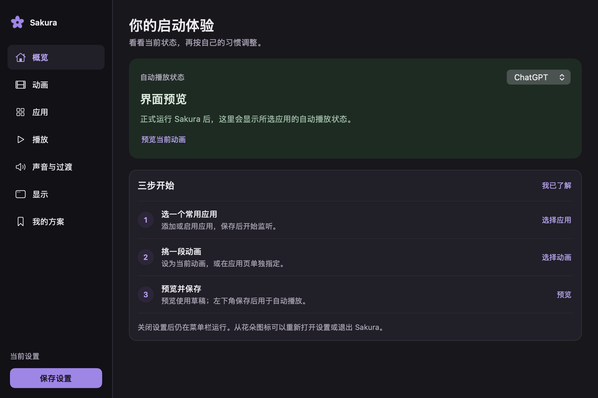

# 开发指南

## 前提

Mac 端运行要求 macOS 13+；构建需要包含 Swift 的 Xcode/Command Line Tools。当前构建脚本使用 SwiftPM native build system；请先确认 `swift --version`，使用支持该命令的工具链。

Windows 端使用 Windows 11、.NET 10 SDK（含 Windows Desktop targeting pack）与 WPF。无需连接维护者的测试电脑。两端没有第三方包依赖；系统框架和 SDK 不随源码提供。开发辅助脚本使用 Python 3.10+ 标准库。

## macOS

```sh
bash launcher-macos/scripts/build.sh
swift test --disable-sandbox --build-system native --package-path launcher-macos
```

构建脚本默认将缓存与产物放在 `~/Library/Caches/GardenBoot/`，并在 `launcher-macos/build/Sakura.app` 创建入口。可对每次命令设置 `GARDENBOOT_WORK_ROOT` 使用独立缓存；不修改全局环境。完整本地集成检查（需要图形会话）为：

```sh
bash launcher-macos/scripts/verify.sh
python3 -m unittest discover -s launcher-macos/scripts/tests -v
```

GUI 不可用的退出状态应记录为未执行，不可写成桌面通过。检查输出会生成在 `launcher-macos/checks/`，不提交这些本机日志。

## Windows

在仓库根目录运行 PowerShell：

```powershell
dotnet build launcher-windows/GardenBoot.slnx -c Release
dotnet run --project launcher-windows/GardenBoot.Core.Tests -c Release
```

核心测试是自带控制台测试程序，应使用 `dotnet run`，不以一次空的 `dotnet test` 代替测试结果。WPF 界面检查需要已登录桌面会话；仅通过 SSH 编译不能证明托盘或播放器行为。

普通构建需要目标电脑安装 .NET 10 Windows Desktop Runtime。若希望分发时自带运行时，可另行验证：

```powershell
dotnet publish launcher-windows/GardenBoot.App -c Release -r win-x64 --self-contained true -o artifacts/windows-x64
```

自包含与单文件是不同选项。动画包资源需随发布目录保留；本轮不承诺单 EXE 发布已经兼容。正式附件应另行完成许可、签名与安装测试。

## 示例媒体

仓库已包含小型 CC0 示例，普通构建不需要 FFmpeg。可选的再生成方式：

```sh
bash launcher-macos/demo-pack/generate.sh
```

脚本使用当前命令 PATH 中的 `ffmpeg`，也可仅对这次命令指定 `SAKURA_FFMPEG` 为本机二进制路径；不安装工具、不写全局 PATH，也不下载素材。

## 公开范围

```sh
python3 -m unittest discover -s scripts/tests -v
python3 scripts/check-public-tree.py
python3 scripts/export-public.py ../Sakura-public
```

目标目录必须不存在。导出仅复制 `public-files.txt` 中的文件，不复制 Git 元数据、历史、机器配置或未列出的内容；不会创建远端仓库或推送。导出目录可再运行 `python3 scripts/check-public-tree.py --strict` 验证没有额外文件。

CI 运行范围与桌面验收边界见[验证说明](VERIFICATION.md)。

## 界面预览

只渲染自身设置页面，不启动目标应用；可使用一个临时空目录隔离数据：

```sh
launcher-macos/build/Sakura.app/Contents/MacOS/GardenBoot --render-settings overview.png --page overview --appearance light --size 820x560 --test-root /tmp/Sakura-render
python3 launcher-macos/scripts/check-design-render.py
```

`--size` 仅用于离屏设置渲染，范围为宽 820–1600、高 560–1200；默认 960 × 640，PNG 以 2× 输出。该入口不连接运行状态，状态区明确显示“界面预览”。运行中的应用通过实际控制器展示已保存配置的状态。



动画库界面：[浅色](images/settings-light.png) · [深色](images/settings-dark.png)。应用页（含“测试”结论示例）：[浅色](images/targets-light.png) · [深色](images/targets-dark.png)。应用页示例使用占位应用标识，因此显示通用图标，不出现其他公司的应用图标。

截图使用隔离数据和 CC0 示例，由应用自身的离屏渲染入口生成，未捕获私人桌面或应用内容。
